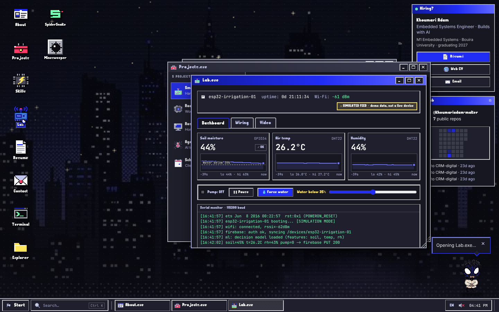
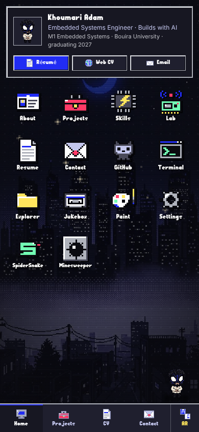
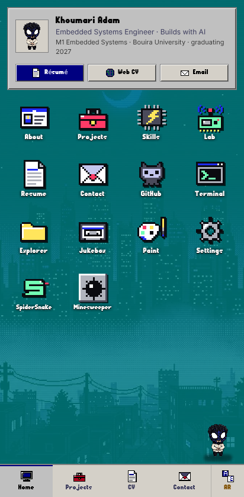

# Adam OS — Khoumari Adam's portfolio

A Windows 98-style desktop you can actually use: draggable windows, a Start menu, a terminal, games and a pixel-art spider who gives tips. It's the portfolio of **Khoumari Adam**, an embedded systems engineer (ESP32, robotics, Raspberry Pi AI home lab) from Bouira, Algeria. English and Arabic (right-to-left).



<p align="center"> </p>

**Recruiter?** Skip the fun and open the plain résumé at [`/resume`](src/app/resume/page.tsx) — it's linked from the boot screen, the desktop "Hiring?" card and the Start menu.

## What's inside

| App | What it does |
| --- | --- |
| About.exe | Bio, quick facts and an experience timeline |
| Projects.exe | Case studies: why, what I built, result, stack |
| Skills.exe | Skills mapped to where they were used (no made-up percentages) |
| Lab.exe | Simulated ESP32 irrigation dashboard: live sparklines, pump logic, wiring diagram, demo video slot |
| Breadboard.exe | A 3D breadboard circuit simulator: wires, resistors, LEDs, push buttons, a buzzer, a potentiometer, capacitors and a multimeter, powered by a 9 V or AA battery. See below |
| Resume.exe | CV download (EN/AR PDF) with a little spider animation |
| Contact.exe | Email, copy address, GitHub, and a message form that opens your own mail app |
| Terminal.exe | `help`, `neofetch`, `ls`/`cd`/`cat`, `open <app>`, `sudo hire-adam`, tab completion and history |
| GitHub.exe | Live public GitHub activity: repos, recent pushes and a 7-week heatmap (no backend) |
| Paint.exe | Pixel-art editor: drag to draw (finger, pen or mouse), pencil, eraser, fill, eyedropper, line, mirror, undo/redo, 16 or 32 px canvas, autosave, PNG export |
| Explorer, Jukebox, Settings | Classic accessories. Settings has the theme, wallpapers, living wallpaper, CRT bloom, screensaver and cursor |
| SpiderSnake, Minesweeper | Games, with best scores saved locally |

**Breadboard.exe** is a real circuit simulator, not an animation. Pick a part, then tap two holes to place its legs. The board's metal strips connect like a real breadboard: every five-hole column in a–e (and in f–j) is one strip, and each power rail is one long strip. Hover a hole (or tap it) to see its strip and its voltage. Behind it is a DC solver using Modified Nodal Analysis, the method SPICE uses, with piecewise-linear LED and buzzer models (`src/lib/circuit/solver.ts`). So:
- LED brightness follows the real current, and each colour needs its own forward voltage (a blue LED won't light from 3 V)
- an LED with no resistor flares, flickers and burns out with a puff of smoke (tap it and press *Replace*)
- LEDs in series share one current, and LEDs in parallel split it unevenly
- hold a push button to close it; the buzzer beeps through your speakers when current flows the right way
- wiring + straight to − shows a short-circuit warning and the battery glows hot
- yellow dots show the current flowing (conventional direction, faster for more current)
- drag a potentiometer's knob to dim an LED
- capacitors charge and discharge in real time (the solver steps through time with a backward-Euler model), so an LED can fade out after you let go of a button; plug one in backwards and it vents with a bang
- the multimeter's red and black probes go in any two holes and its LCD shows the voltage between them

It has eight example circuits, undo, Move (pick a part back up), keyboard shortcuts (V select, W wire, R resistor, L LED, B button, Z buzzer, P pot, C capacitor, M meter, X delete, Ctrl+Z undo), a top view, a retro pixel mode and an inspector showing current, voltage and tips for the selected part. Phones get a top view for placing parts, the board turned lengthwise and tap-to-place. The 3D engine (three.js via react-three-fiber) only downloads when the app is opened.

Desktop details: snap windows by dragging them to the screen edges, double-click a title bar to maximize, rubber-band select icons, right-click the desktop, use <kbd>Ctrl</kbd>+<kbd>K</kbd> to search everything, and <kbd>Esc</kbd> to close a window. Window positions, the wallpaper and settings are remembered between visits. Returning visitors skip the boot screen (add `?boot` to replay it).

Phones get a home screen with every app, full-screen app sheets and a bottom tab bar.

**Look and feel**
- Two themes: *Spider Night* (dark cobalt) and *Windows 98* (silver, navy and teal). Switch in Settings or with <kbd>Ctrl</kbd>+<kbd>K</kbd> → "theme".
- One hand-made pixel icon set (`src/lib/pixel-icons.ts`) used for the app icons and every UI glyph. Icons follow the theme colours.
- **Pixel Spider**, the mascot, has 31 animations (walk, run, climb, hop, dance, wave, sit, stretch, yawn, scratch, sneeze, kick, shrug, thumbs-up, laugh, shoot-web, typing, sleep, love, dizzy, annoyed, surprised, dangle, fall, land…) and a small physics engine. He always has something to do: every few seconds he walks or runs along the taskbar, jumps onto windows with an aimed physics arc, climbs up and rappels down on his thread, patrols and sits on title bars, chases your cursor and shoots webs at it, or does a little trick.
  - drag him around on his web and throw him: he falls with gravity, bounces, and lands on the floor or on a window's title bar, then rides along when you move that window (and falls off if you close it)
  - wiggle the cursor over him to pet him; click him too often and he gets annoyed, then dizzy
  - he follows the cursor with his eyes, walks along the taskbar, web-swings onto the window you're using, naps when you go idle and wakes up when you come back
  - yank a window he's standing on and he loses his balance; throw him hard and he lands dizzy; hover over him for a reaction, park your cursor near him and he waves
  - right-click him for a menu (pet, dance, jump, wave, web-swing, shoot web, trick, thumbs up, sit, nap, go home, hide); the terminal has `pet`, `dance`, `nap`, `jump`, `trick`, `web` and `sit`; the Jukebox makes him dance; the Konami code starts a dance break
  - he's drawn at exactly half the 256px art size (pixel-perfect on high-DPI screens); hide him in Settings or with Ctrl+K
- Windows grow out of their icon when opened and shrink into the taskbar when minimized.
- A BIOS screen, then an "Adam OS 98" splash on first visit.
- Living wallpapers: twinkling stars, fireflies and drifting clouds, drawn on a low-res canvas so they stay pixel-crisp.
- Arabic uses Reem Kufi for titles and IBM Plex Sans Arabic for text.
- Every animation respects the system "reduce motion" setting.

## Run it

```bash
npm install
npm run dev        # http://localhost:3000
npm run build      # static site in ./out
npm start          # serve ./out locally
npm run typecheck
npm run test:visual   # screenshot tests (run `npm run build` first)
npm run test:circuit  # checks the circuit solver against hand calculations
```

The visual tests compare desktop and phone screenshots (dark, classic, Arabic, Projects, /resume) with the baselines in `tests/visual/__screenshots__/`, and check that phones never scroll sideways. After an intended visual change, update the baselines with `npm run test:visual -- --update-snapshots`. Baselines were made on Linux Chromium; other systems render fonts slightly differently.

## Deploy

It's a fully static export, so it needs no server.

- **Vercel (live site):** https://adam-os-two.vercel.app redeploys automatically on every push to `main`. The build command is `npm run build` and the output directory is `out`.
- **GitHub Pages (optional mirror):** turn on *Settings → Pages → Source: GitHub Actions*, then run **Deploy to GitHub Pages** from the Actions tab. The workflow sets the `/adam-os` base path for you.

Environment variables (both optional):

- `NEXT_PUBLIC_BASE_PATH`: set it when the site lives under a sub-path, e.g. `/adam-os`.
- `NEXT_PUBLIC_SITE_URL`: the public URL, used for social previews and the sitemap.

## Edit the content

| What | Where |
| --- | --- |
| Email, GitHub, LinkedIn, résumé files | `src/lib/profile.ts` (an empty field is hidden everywhere) |
| Projects (+ photos and links) | `src/lib/content/projects.ts`. Add photos to `public/projects/<id>.jpg` |
| Plain résumé page | `src/lib/content/resume.ts` |
| Interface text (EN/AR) | `src/lib/i18n/en.json`, `src/lib/i18n/ar.json` |
| Apps on the desktop / Start menu | `src/lib/apps.ts` |
| Lab demo video | drop a file at `public/lab/demo.mp4` |
| Icons | edit `src/lib/pixel-icons.ts`, then `python3 scripts/icons/render_icons.py --force` to refresh the desktop PNGs |
| Mascot animation frames | `python3 scripts/mascot/build_frames_v2.py` (rebuilds `public/mascot/v2/*.png` and `anims.json` from `idle-01.png`) |
| Theme colours | CSS variables at the top of `src/app/globals.css` |
| Breadboard example circuits, parts | `src/lib/circuit/presets.ts`, `src/lib/circuit/parts.ts` |

Any path to a file in `public/` must go through `asset()` from `src/lib/asset.ts`, so the site keeps working under a sub-path.

## Tech

Next.js 14 (app router, static export) · React 18 · TypeScript · Tailwind CSS · Framer Motion · three.js with react-three-fiber (Breadboard.exe only, lazy-loaded). Sounds are synthesized with the Web Audio API, so there are no audio files. There's no backend, no analytics and no cookies.

The project started from an AI agent pipeline. The original spec and agent workflows are in `adam-os-spec/` and `.agent/`.
